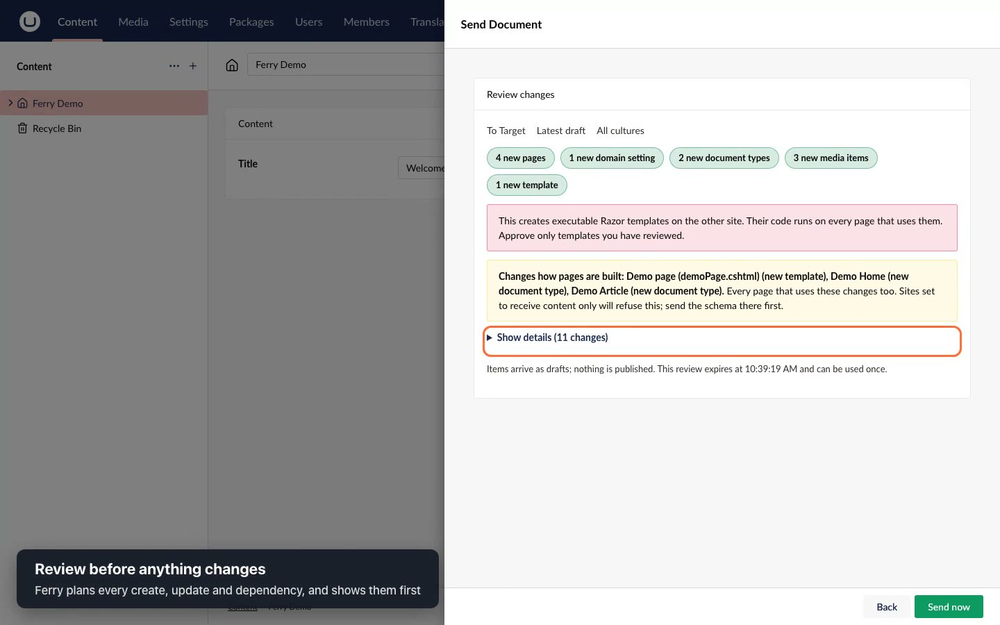
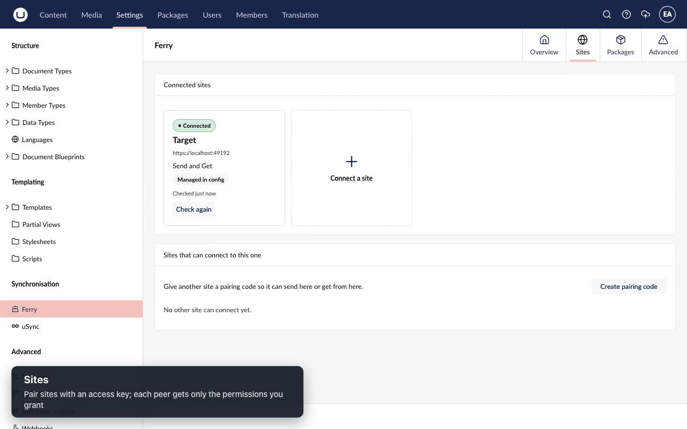
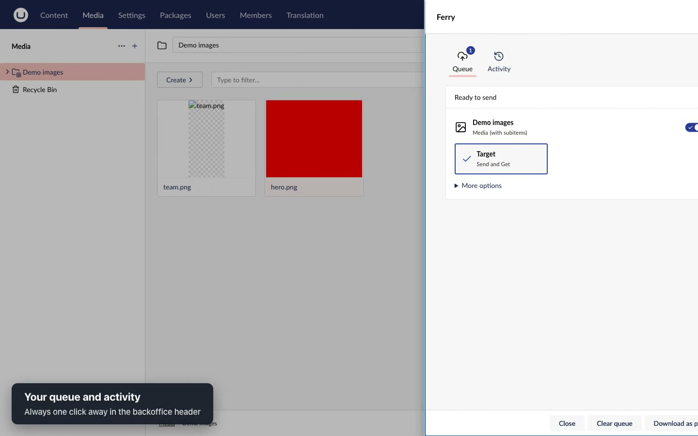

<div class="fy-hero" markdown>
<div class="fy-hero__inner" markdown>

<h1 class="fy-hero__title">Ferry</h1>
<p class="fy-hero__tagline">Move Umbraco content and schema between sites, <strong>reviewed before anything changes</strong>.</p>
<p class="fy-hero__sub">Code-first schema and safe content deployment for Umbraco 17, from development to staging to live.</p>
<div class="fy-hero__actions">
<a class="md-button md-button--primary" href="overview/#quick-start">Get started</a>
<a class="md-button" href="#tour">Watch the tour</a>
<a class="md-button" href="https://www.nuget.org/packages/Ferry.Umbraco">NuGet</a>
</div>
<pre class="fy-hero__install"><code>dotnet add package Ferry.Umbraco --prerelease
dotnet add package Ferry.Backoffice --prerelease</code></pre>
</div>
</div>

<div class="fy-section" markdown>
<div class="fy-grid">
<div class="fy-card">
<h3>Reviewed transfers</h3>
<p>Send and Get pages, media and their dependencies between sites. Every change is planned and shown first. Items arrive as drafts, or published when you choose. Send a whole tree from the Content or Media root in one action.</p>
</div>
<div class="fy-card">
<h3>Schema as code</h3>
<p><code>SchemaBuilder</code> migrations and generated C# migrations keep document types, data types and templates identical on every environment, with drift reported.</p>
</div>
<div class="fy-card">
<h3>Packages and snapshots</h3>
<p>Export offline <code>.ferry.zip</code> packages, import them by drag and drop or at startup, and keep restore points.</p>
</div>
<div class="fy-card">
<h3>Safe on real sites</h3>
<p>Fingerprinted reviews that can be used once, per-site permissions, one operation at a time and a recovery journal for every apply.</p>
</div>
<div class="fy-card">
<h3>Extensible</h3>
<p>Value mappers for your own property editors and package providers for data outside content. Skybrud redirects and Umbraco Forms included.</p>
</div>
<div class="fy-card">
<h3>Free to use</h3>
<p>Free for any site, including commercial work, under the <a href="license/">Ferry Freeware License</a>. Needs no other synchronisation tool.</p>
</div>
</div>
</div>

<div class="fy-section fy-section--tint" markdown>
<h2 id="tour" class="fy-heading">See it in action</h2>
<p class="fy-lead">Two sites, one reviewed Send: the options, the review, the result on the target, and a repeat that changes nothing.</p>
<video class="fy-video" controls preload="metadata" poster="assets/images/poster.jpg">
<source src="assets/ferry-showcase.mp4" type="video/mp4">
</video>
</div>

<div class="fy-section" markdown>
<h2 class="fy-heading">Built into the backoffice</h2>
<div class="fy-shots">
<figure><figcaption><strong>Review</strong> every create, update and dependency before it is applied.</figcaption></figure>
<figure><figcaption><strong>Sites</strong>: pair with a code and grant each peer only what it needs.</figcaption></figure>
<figure><figcaption><strong>Queue</strong> items across the tree and send them together.</figcaption></figure>
</div>
</div>

<div class="fy-section fy-section--tint" markdown>
<h2 class="fy-heading">Try it in three steps</h2>
<div class="fy-steps" markdown>
<div class="fy-step" markdown>
<span class="fy-step__n">1</span>

**Install** on each site.

```sh
dotnet add package Ferry.Umbraco --prerelease
dotnet add package Ferry.Backoffice --prerelease
```
</div>
<div class="fy-step" markdown>
<span class="fy-step__n">2</span>

**Register** Ferry in `Program.cs`.

```csharp
builder.CreateUmbracoBuilder()
    .AddBackOffice()
    .AddWebsite()
    .AddComposers()
    .AddFerryUmbracoFull()
    .Build();
```
</div>
<div class="fy-step" markdown>
<span class="fy-step__n">3</span>

**Connect** the sites: on one, *Settings › Ferry › Sites › Create pairing code* (tick *Allow two-way* to connect both directions); on the other, *Connect a site* and paste it. Codes work once. Then pick a page, *Actions › Send to…*, and review.
</div>
</div>
<p class="fy-center"><a class="md-button md-button--primary" href="overview/">Read the overview</a> <a class="md-button" href="extending/">Extend Ferry</a></p>
</div>
